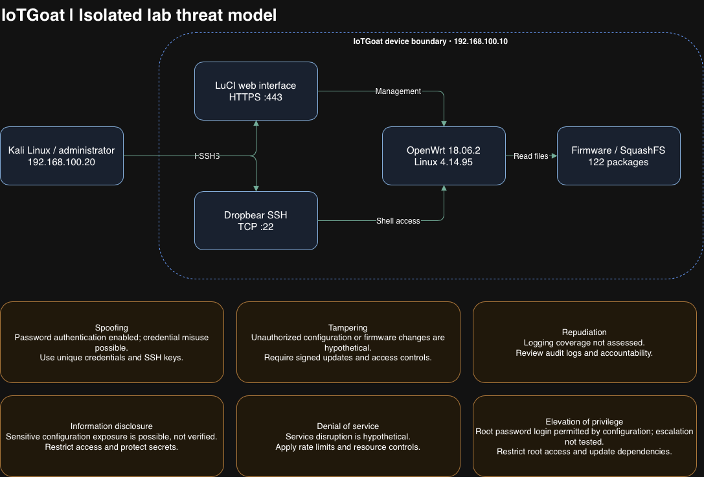

# IoTGoat Threat Modeling

## Overview

This threat model evaluates the security architecture, attack surface, trust boundaries and potential security risks of an embedded IoT device using OWASP IoTGoat.

## Threat Model Diagram

 

## Methodology

The assessment uses the STRIDE threat modeling framework to identify potential threats and recommend security controls.

## Assessment Scope

- OWASP IoTGoat v1.0
- OpenWrt 18.06.2
- Linux Kernel 4.14.95
- LuCI web management interface
- Dropbear SSH service
- Embedded firmware and SquashFS filesystem
- Isolated VirtualBox network

## STRIDE Threat Assessment

| Category | Identified Risk | Status |
|---|---|---|
| Spoofing | Credential misuse | Weak password policy confirmed |
| Tampering | Unauthorized firmware or configuration changes | Potential |
| Repudiation | Insufficient audit logging | Not assessed |
| Information Disclosure | Exposure of sensitive configuration data | Not validated |
| Denial of Service | Service disruption | Not tested |
| Elevation of Privilege | Privileged account compromise | Root password login enabled; escalation not tested |

## Recommended Security Controls

- Enforce strong authentication.
- Restrict privileged account access.
- Disable deprecated cryptographic algorithms.
- Implement signed firmware updates.
- Strengthen network access controls.
- Implement security logging and monitoring.
- Maintain software component inventories.

## Related Security Assessments

- [Initial Security Assessment](../reports/security-assessment.md)
- [Firmware Security Assessment](../reports/firmware-security-assessment.md)

## Limitations

The primary threat model represents the isolated laboratory environment. Internal data flows are conceptual and require further validation.

The broader IoT infographic represents a hypothetical production deployment, not confirmed laboratory findings.

Threat identification does not establish successful exploitation. Additional vulnerability validation and remediation testing remain ongoing.
